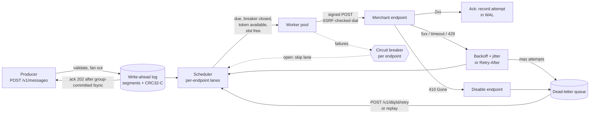

# webhook-relay-go

[](https://github.com/victorcondackdev/webhook-relay-go/actions/workflows/ci.yml)
[](https://pkg.go.dev/github.com/victorcondackdev/webhook-relay-go)

A reliable outbound webhook delivery service and Go library for payment
platforms: the component that tells merchants `pix.received` or
`charge.paid`, keeps trying when they are down, and never loses an event it
has acknowledged.

- **Durable by default**: an embedded, segmented write-ahead log with CRC32-C
  per record, torn-write recovery, group commit and compaction. No database
  required to run it; a `Store` interface to plug one in.
- **At-least-once delivery** with a configurable retry schedule, full or
  partial jitter, `Retry-After` support, a dead-letter queue, manual retry and
  replay.
- **Isolation per merchant**: circuit breaker, concurrency limit, token-bucket
  rate limit and optional FIFO ordering, per endpoint.
- **Standard Webhooks signatures** (`webhook-id`, `webhook-timestamp`,
  `webhook-signature`), HMAC `v1` and ed25519 `v1a`, with zero-downtime
  secret rotation. The `signature` package is importable by receivers.
- **SSRF protection** enforced on the connected IP after DNS resolution and on
  every redirect, so merchant-supplied URLs cannot reach your VPC or the cloud
  metadata service.
- **Standard library only.** Prometheus metrics, JSON logs and trace context
  propagation without a single dependency.

## Why

Every payment platform ends up writing this, and the first version is usually
a goroutine that POSTs and logs on failure. The failure modes show up later,
in production: a merchant that is down for six hours eats all the workers; a
retry storm hits a merchant that just came back; a deploy restarts the
process and the in-memory retry queue is gone; a merchant registers
`http://169.254.169.254/` as their webhook URL. This project is a compact,
well-tested answer to each of those, small enough to read in an afternoon.

## Architecture



Every state change (endpoint, message plus its deliveries, attempt plus the
delivery's new state) is one WAL record. The scheduler is an in-memory index
rebuilt from the store on startup; the store is the source of truth.

## Delivery guarantees

What **is** guaranteed:

- `POST /v1/messages` returns only after the message and one delivery per
  subscribed endpoint are in the WAL. With `-fsync always` (the default) that
  means fsynced; concurrent producers share fsyncs through group commit.
- **At-least-once**: each delivery is attempted until the endpoint returns a
  2xx, the attempt budget is exhausted (dead-letter queue), or the endpoint
  returns `410 Gone` (endpoint disabled, its queue dead-lettered). A crash at
  any point leads to a re-attempt after restart.
- `webhook-id` is the message id and is identical on every retry, manual
  retry and replay. Receivers deduplicate on it.
- On **ordered** endpoints at most one request is in flight and messages are
  sent in the order the relay accepted them; a message is not sent until the
  previous one has succeeded or been dead-lettered.
- A graceful shutdown (`SIGTERM`) stops the API, then waits for in-flight
  requests up to `-shutdown-timeout`. Requests abandoned at the deadline are
  not counted as attempts and are retried on the next start.

What is **not** guaranteed:

- **Exactly-once.** Duplicates are expected: a receiver can process a request
  and time out before answering, or the relay can crash after the 2xx and
  before recording it.
- **Ordering** across endpoints, on parallel (non-ordered) endpoints, or
  between messages published concurrently.
- **Delivery to an endpoint that is down longer than the schedule**
  (about 28 hours by default). Those deliveries land in the DLQ, from where
  they can be retried or replayed.
- **Wall-clock bounds while a breaker is open.** Time spent behind an open
  breaker does not consume attempts, so a delivery can stay pending longer
  than the schedule suggests; that is the point of the breaker.
- With `-fsync interval` or `-fsync never`, acknowledged messages written in
  the last interval can be lost on power failure (not on a process crash).
- **High availability.** One `relayd` owns one WAL directory. See the design
  notes for a multi-node path.

## Retry schedule

The default schedule is `5s, 5m, 30m, 2h, 5h, 10h, 10h`: eight attempts over
about 28 hours. Each delay `d` is randomised within `[0.8d, d]`
(`Jitter: 0.2`) so deliveries that failed together do not retry in lockstep;
`Jitter: 1` is AWS-style full jitter, uniform in `[0, d]`. An `Exponential`
backoff (base, cap, attempts, jitter) is also provided, and any `Backoff`
implementation can be plugged in.

| Attempt | Delay after previous | Elapsed since publish |
|--------:|---------------------:|----------------------:|
| 1 | immediate | 0 |
| 2 | 5 s | 5 s |
| 3 | 5 min | 5 min 5 s |
| 4 | 30 min | 35 min |
| 5 | 2 h | 2 h 35 min |
| 6 | 5 h | 7 h 35 min |
| 7 | 10 h | 17 h 35 min |
| 8 | 10 h | 27 h 35 min |
| | dead-letter queue | |

How responses are treated:

| Response | Outcome | Effect |
|---|---|---|
| `2xx` | `success` | done |
| `429`, or `503` with `Retry-After` | `throttled` | retry after `Retry-After` (clamped to 1 s .. `MaxRetryAfter`, default 6 h), otherwise the schedule |
| `410 Gone` | `gone` | endpoint disabled, its pending deliveries dead-lettered |
| `3xx` | `redirect` | retried; redirects are not followed unless enabled |
| other `4xx`, `5xx` | `http_4xx`, `http_5xx` | retried on the schedule |
| timeout, connection error | `timeout`, `network` | retried on the schedule |
| address refused by the SSRF guard | `blocked` | dead-lettered immediately |

The breaker opens after 5 consecutive failures, stays open 30 s, lets a single
probe through, and doubles the cool-down on each failed probe up to 10 minutes.

## Security

**Signatures.** Deliveries follow the
[Standard Webhooks](https://www.standardwebhooks.com) scheme: the signed
content is `id.timestamp.body`, `v1` is base64 HMAC-SHA256 with a `whsec_`
secret, `v1a` is ed25519 with a `whsk_` key whose `whpk_` public half is what
the merchant holds. Verification checks the timestamp against a 5-minute
tolerance and compares MACs in constant time. The implementation reproduces
the published reference test vector (`signature/signature_test.go`).

```go
v, _ := signature.NewVerifier(os.Getenv("WEBHOOK_SECRET"))
body, _ := io.ReadAll(io.LimitReader(r.Body, 1<<20))
if err := v.Verify(r.Header, body); err != nil {
	http.Error(w, "invalid signature", http.StatusUnauthorized)
	return
}
```

**Rotation.** `PATCH /v1/endpoints/{id}` with `{"rotate_secret": true}`
returns a new secret. For the next 24 h (`KeyRotationOverlap`) every delivery
carries two signatures, one per secret, so the merchant can deploy the new
secret whenever convenient; a receiver configured with both
(`NewVerifier(old, new)`) accepts either. After the overlap the old secret
stops signing.

**SSRF.** Endpoint URLs are attacker-controlled input. The guard:

- requires `https` (plain `http` only with `-allow-http`) and rejects
  credentials in URLs;
- resolves the host itself and connects only to an allowed IP, so a name
  that resolves, or re-resolves, to an internal address is refused (DNS
  rebinding does not help);
- blocks loopback, RFC 1918, unique-local, link-local (including
  `169.254.169.254` and `fd00:ec2::254`), CGNAT (including `100.100.100.200`),
  NAT64/6to4/Teredo (which embed IPv4), multicast, documentation and reserved
  ranges, and IPv4-mapped forms of all of these;
- re-checks the socket address in a `net.Dialer` `Control` hook;
- never uses an HTTP proxy (a proxy would connect on our behalf);
- does not follow redirects by default; with `-follow-redirects` each hop is
  validated and dialled through the same guard.

Private ranges that should be reachable (an internal consumer in the same VPC)
are opted in explicitly with `-allow-cidrs 10.20.0.0/16`.

**API.** Set `RELAY_API_TOKEN` to require `Authorization: Bearer ...` on every
`/v1` route (compared in constant time; deliberately not a flag, so it does
not appear in `ps`). Secrets are returned only on creation, on rotation and by
`GET /v1/endpoints/{id}/secret` (`Cache-Control: no-store`). Request bodies,
payloads (256 KiB) and stored response snippets (1 KiB, sanitised) are
bounded.

## Quick start

```sh
go run ./cmd/relayd -addr :8080 -data ./data
# or
docker build -t webhook-relay-go . && docker run -p 8080:8080 -v relay-data:/var/lib/webhook-relay webhook-relay-go
```

Register an endpoint (the secret is shown once):

```sh
curl -s localhost:8080/v1/endpoints -d '{
  "url": "https://merchant.example/webhooks",
  "event_types": ["pix.*", "charge.paid"],
  "max_concurrency": 4,
  "rate_limit": 20
}'
# {"id":"ep_019a...","secret":"whsec_...","event_types":["pix.*","charge.paid"],...}
```

Publish an event; repeat it with the same key and nothing is sent twice:

```sh
curl -s localhost:8080/v1/messages \
  -H 'Idempotency-Key: pix-E00000000202611211200abc' \
  -H 'traceparent: 00-4bf92f3577b34da6a3ce929d0e0e4736-00f067aa0ba902b7-01' \
  -d '{"event_type":"pix.received","payload":{"txid":"E00000000202611211200abc","amount":1500}}'
```

Inspect and recover:

```sh
curl -s localhost:8080/v1/messages/msg_019a.../attempts     # status, latency, response snippet per attempt
curl -s localhost:8080/v1/dlq?endpoint_id=ep_019a...
curl -s -X POST localhost:8080/v1/dlq/dlv_019a.../retry
curl -s -X POST 'localhost:8080/v1/endpoints/ep_019a.../replay?since=2026-11-21T00:00:00Z'
curl -s -X PATCH localhost:8080/v1/endpoints/ep_019a... -d '{"rotate_secret":true}'
curl -s localhost:8080/metrics
```

Errors are RFC 9457 problem details (`application/problem+json`). The full
route list is in the [`api`](api/api.go) package documentation, and
[`examples/receiver`](examples/receiver/main.go) is a merchant-side consumer
that verifies signatures and deduplicates on `webhook-id`.

### Using the library

```go
store, err := relay.OpenFileStore(relay.FileStoreOptions{Dir: "/var/lib/relay", Sync: wal.SyncAlways})
eng, err := relay.New(relay.Config{Store: store, Logger: slog.Default()})
eng.Start(ctx)
defer eng.Shutdown(shutdownCtx)

ep, err := eng.CreateEndpoint(ctx, relay.EndpointSpec{URL: "https://merchant.example/webhooks", Ordered: true})
msg, deliveries, created, err := eng.Publish(ctx, relay.PublishInput{
	EventType: "charge.paid", Payload: payload, IdempotencyKey: "charge-ch_123-paid",
})
```

## Observability

- `GET /metrics` (Prometheus text format, hand-written):
  `webhook_attempts_total{outcome}`, `webhook_deliveries_succeeded_total`,
  `webhook_deliveries_failed_total{class}` (dead-lettered, by last outcome),
  `webhook_attempt_duration_seconds` (histogram), `webhook_queue_depth`,
  `webhook_inflight_requests`, `webhook_dlq_depth`,
  `webhook_breaker_state{endpoint}` (0 closed, 1 half-open, 2 open),
  `webhook_messages_published_total`.
- JSON logs via `log/slog`: one line per attempt with delivery, message and
  endpoint ids, outcome, status, latency and next attempt time.
- The producer's W3C `traceparent` / `tracestate` are stored with the message
  and forwarded on every attempt, so a merchant's trace links back to the
  payment that caused it. Invalid trace context is dropped rather than
  forwarded.
- `GET /v1/messages/{id}/attempts` is the per-message audit trail.

## Benchmarks

Linux amd64, 2 vCPU Xeon @ 2.1 GHz (shared cloud VM), Go 1.24.7, container
filesystem. Reproduce with `go test -run '^$' -bench . ./...`.

| Benchmark | Result |
|---|---|
| WAL append, 512 B, `fsync=never` | 1.8 µs/op (284 MB/s) |
| WAL append, 512 B, `fsync=interval` | 1.7 µs/op (308 MB/s) |
| WAL append, 512 B, `fsync=always`, 1 writer | 134 µs/op (~7.4k appends/s) |
| WAL append, 512 B, `fsync=always`, 32 writers (group commit) | 34 µs/op (~29k appends/s) |
| Signature verify, 1 KiB body | 2.4 µs/op |
| End to end, in-memory store | ~14,000 deliveries/s |
| End to end, WAL `fsync=never` | ~10,000 to 12,500 deliveries/s |
| End to end, WAL `fsync=always` | ~6,100 deliveries/s |

"End to end" is 8 producers publishing to one endpoint served by a local
`httptest` server answering 204: each delivery is a publish (one WAL record),
a signed HTTP POST over keep-alive, and an attempt record (one WAL record).
Real merchants are network-bound; the numbers show the relay's own overhead
and that fsync cost is amortised by group commit rather than paid per event.

## Testing

```sh
go test -race ./...                                     # coverage: 93.6% of statements
go test -run '^$' -fuzz FuzzDecodeRecord -fuzztime 15s -fuzzminimizetime 1s ./wal
go test -run '^$' -fuzz FuzzVerifyValues -fuzztime 15s -fuzzminimizetime 1s ./signature
```

Highlights:

- **Crash recovery**: random histories of store mutations are written, the
  newest segment is cut at a random byte offset (optionally followed by
  garbage), and the reopened store must equal the state after some prefix of
  the history, never a torn record, and must keep accepting writes. Separate
  tests cover a crash mid-compaction and a crash after compaction but before
  old segments were deleted.
- **Fuzzing** of the WAL record decoder (never panics, round-trips) and of the
  signature verifier (never panics, never accepts a forged header).
- **Delivery behaviour** against a scripted `httptest` server: fails N times,
  slow responses and timeouts, `429`/`503` with `Retry-After`, `410`,
  redirects, refused connections.
- **Fake clock** tests assert the exact retry instants of the schedule, the
  breaker cool-downs and the token bucket.
- **Breaker state machine** table test; **SSRF** table tests plus a custom
  resolver that points names at loopback and metadata addresses.
- **Race tests**: concurrent producers, readers and workers on the file store,
  concurrent WAL appenders under every sync policy.

## Design notes

**Why a WAL instead of a database by default.** The relay's write pattern is
append-heavy and its working set (pending deliveries, recent messages) is
small. A purpose-built log gives durable acknowledgements with one sequential
write and a shared fsync, no extra moving part to operate, and a recovery
procedure that is short enough to reason about and to test exhaustively. The
whole state lives in memory and the log is replayed on start (the Redis AOF
or Bitcask model); compaction rewrites the live state into a fresh segment
between begin/end markers and drops messages that were fully acknowledged and
are older than the retention window (72 h, which also bounds replay). The
trade-off is explicit: the working set must fit in memory and a WAL directory
has a single owner.

Recovery rules: a bad record at the tail of the newest segment is a torn
write and is truncated; the same in an older segment cannot come from a crash
(segments are always fsynced before the next one is created), so it is
reported as corruption instead of silently dropping acknowledged data.

**Plugging in Postgres.** Implement `relay.Store`; every method is meant to
be one transaction:

```sql
create table endpoints  (id text primary key, doc jsonb not null);
create table messages   (id text primary key, idempotency_key text unique,
                         event_type text not null, payload jsonb not null,
                         created_at timestamptz not null);
create table deliveries (id text primary key, message_id text references messages,
                         endpoint_id text references endpoints on delete cascade,
                         seq bigint not null, state text not null, attempts int not null,
                         next_attempt_at timestamptz not null, doc jsonb not null);
create index on deliveries (state, next_attempt_at);
create table attempts   (id text primary key, message_id text not null, doc jsonb not null);
```

`CreateMessage` is `insert ... on conflict (idempotency_key) do nothing`
followed by a read of the existing row; `RecordAttempt` inserts the attempt
and updates the delivery in the same transaction. The engine then works
unchanged. Running several relay nodes against one database additionally
needs work claiming (`select ... for update skip locked` on due deliveries,
with a lease) in place of the single-process scheduler; the `Store` boundary
was drawn so that change stays inside the store and the scheduler.

**Scheduling.** Each endpoint is a lane with its own heap (by due time, or by
sequence for ordered lanes), breaker, token bucket and in-flight counter. A
single dispatcher hands due work to a fixed worker pool, round-robin across
lanes, and sleeps until the earliest of: next due time, breaker probe time,
next token. A dead merchant therefore costs nothing but its pending entries,
and a slow one is capped at its concurrency limit while others proceed.

**Standard Webhooks notes.** `v1` is verified against the published reference
vector. For `v1a`, keys are encoded as `whsk_`/`whpk_` plus standard base64;
`whsk_` keys are emitted as the 64-byte seed-plus-public-key form and both the
64-byte and 32-byte seed forms are accepted. The JSON body is the recommended
`{"type", "timestamp", "data"}` envelope, where `timestamp` is the message
creation time and the `webhook-timestamp` header is the time of each attempt.

## Related

- [payments-service-go](https://github.com/victorcondackdev/payments-service-go):
  a payments service that produces the events this relay delivers.

## License

MIT. See [LICENSE](LICENSE).
